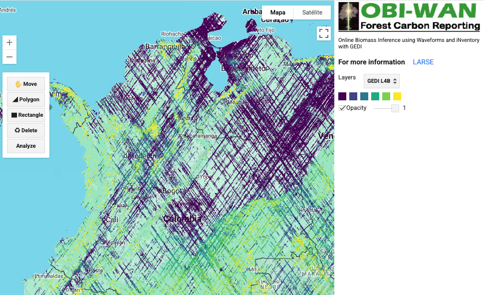

In this  week, we will get familiar with L4A footprints, L4B grids and OBIWAN.

## 👨‍🏫 Lecture Slides 

[Biomass, change and calibration](https://drive.google.com/file/d/1wJI6wgz6cuVpfaI9kUdz_vdsrI8W6xHP/view?usp=sharing).

##  Practical exercises

- [GEE App](https://yang.users.earthengine.app/view/obiwan)

- [Biomass change](https://drive.google.com/file/d/1ueaG1FTP9RmiyXUEh7OptQSsrX-pFg7E/view?usp=sharing)

## Homework

Students continue working on their  *Informe No.2*.

** Upload your inform not later than 3 December at 11:59 pm **

